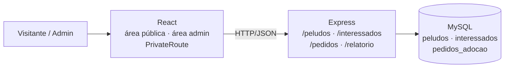

<h1 align="center">🐾 Cafofo dos Peludos</h1>

<p align="center">
  <b>Aplicação full stack para gestão de adoções de animais: site público para adotantes e painel administrativo para a equipe.</b>
</p>

<p align="center">
  
  
  
  
  
</p>

<p align="center">
  <a href="#-como-rodar-localmente">Rodar localmente</a> ·
  <a href="#-testes">Testes</a> ·
  <a href="#-decisões-técnicas">Decisões técnicas</a>
</p>

---

## 🎯 O problema

ONGs e lares temporários costumam controlar animais, interessados e pedidos de adoção em planilhas ou mensagens soltas. Fica difícil saber **quem pediu qual animal, em que status está cada pedido** e quais animais ainda estão disponíveis.

> Projeto da **Avaliação N2 de Programação Web** (Ciência da Computação, UCB).

## ✅ A solução

Uma aplicação com **API REST em Node.js/Express e banco MySQL relacional**, consumida por um front-end React com duas áreas:

- **Área pública:** lista os peludos disponíveis, explica como adotar, divulga feiras de adoção e recebe o interesse do visitante.
- **Área administrativa (com login):** dashboard de solicitações por status, três CRUDs completos com filtros e um relatório que cruza tutor, peludo e pedido.

**Principais funcionalidades**

- CRUD de **peludos** (filtros por busca, tipo e status), **tutores** (busca e cidade) e **solicitações de adoção** (edição de status).
- **Dashboard** com contagem de solicitações por status e pedidos recentes.
- **Relatório** que relaciona as três entidades via `JOIN` no MySQL.
- **Rotas administrativas protegidas** (`PrivateRoute`), com sessão e logout.

## 📸 Demonstração

<!-- Adicione prints em docs/img/ e descomente a tabela abaixo. Sugestão: home pública, dashboard e relatório.
| Área pública | Dashboard | Relatório |
|---|---|---|
|  |  |  |
-->
🎬 *Prints e GIF da aplicação em breve.*

Credenciais de teste da área administrativa: `teste@cafofo.com` / `123456`

## 🛠️ Tecnologias

| Camada | Tecnologia | Por que escolhi |
|---|---|---|
| Front-end | React + React Router DOM | Componentes reaproveitáveis (Layout, Navbar) e rotas protegidas para separar a área pública da administrativa. |
| Estilo | Bootstrap + CSS | Layout responsivo rápido, com foco do projeto nas regras e na API. |
| Back-end | Node.js + Express | API REST enxuta, com uma rota por recurso, e o mesmo JavaScript do front-end. |
| Banco de dados | MySQL (`mysql2`) | Os dados são relacionais: um pedido liga um tutor a um peludo por chaves estrangeiras. |
| Configuração | dotenv | Credenciais do banco fora do código (`.env`). |
| Testes | Jest + Supertest · Cypress | Integração da API contra o banco real e fluxo completo no navegador. |

## 🧱 Arquitetura



**Modelo de dados:** `interessados 1 ── N pedidos_adocao N ── 1 peludos`

**API REST** (`http://localhost:3001`)

| Recurso | Endpoints |
|---|---|
| `/peludos` | `GET /` · `GET /:id` · `POST /` · `PUT /:id` · `DELETE /:id` |
| `/interessados` | `GET /` · `GET /:id` · `POST /` · `PUT /:id` · `DELETE /:id` |
| `/pedidos` | `GET /` · `GET /:id` · `POST /` · `PUT /:id` · `DELETE /:id` |
| `/relatorio` | `GET /` · `GET /:id` · `GET /indicadores/resumo` |

**Estrutura de pastas**

```
Cafofo_dos_peludos/
├── backend/
│   ├── rotas/          # rotas da API (peludos, interessados, pedidos, relatório)
│   ├── tests/          # testes de integração (Jest + Supertest)
│   ├── conexao.js      # conexão com o MySQL
│   └── server.js       # servidor Express
├── banco/
│   └── script_banco_cafofo.sql
├── cypress/e2e/        # testes de sistema (Cypress)
└── src/
    ├── componentes/    # Layout, Navbar e PrivateRoute
    ├── paginas/        # páginas públicas e administrativas
    └── utilitarios/    # controle de imagens no localStorage
```

## 💡 Decisões técnicas

- **Relatório com `JOIN` no banco, não no front-end**: o MySQL já relaciona tutor, peludo e pedido numa consulta só; o React só exibe. *Trade-off:* a rota de relatório fica acoplada ao schema.
- **Testes de integração contra o MySQL real, sem mocks**: pegam erros de SQL, de chave estrangeira e de limite de coluna que um mock esconderia. *Trade-off:* exigem o banco configurado para rodar.
- **Partição de equivalência e valor-limite** para escolher os casos de teste: ex.: nome com 260 caracteres para estourar o `VARCHAR`, cadastro sem e-mail como classe inválida.
- **Imagens dos peludos fora do banco**: o MySQL guarda só os dados; as fotos são associadas ao `id` no front-end (`localStorage`), o que manteve o escopo da avaliação. *Trade-off:* as imagens não são compartilhadas entre navegadores; um próximo passo seria um storage de arquivos.
- **Login simulado no front-end**, como pedia a avaliação, com sessão em `localStorage` e `PrivateRoute`. *Trade-off:* não é autenticação real; o próximo passo é JWT no back-end.

## 🧪 Testes

| Tipo | Ferramenta | Quantidade | O que cobre |
|---|---|---|---|
| Integração | Jest + Supertest | 7 | Endpoints da API contra o MySQL: cadastro válido, valor-limite, campos obrigatórios, listagem e relatório |
| Sistema (E2E) | Cypress | 4 | CRUD de tutores pela interface: formulário vazio, cadastro, edição e exclusão |

<details>
<summary>Casos de teste de integração</summary>

| Arquivo | Caso de teste | Técnica | Resultado esperado |
|---|---|---|---|
| `peludos.test.js` | Cadastro de peludo com dados válidos | Caminho feliz | `201` + mensagem de sucesso |
| `peludos.test.js` | Nome com 260 caracteres (acima do `VARCHAR`) | Valor-limite | Erro (`≥ 400`), sem gravar no banco |
| `interessados.test.js` | Cadastro com todos os campos obrigatórios | Partição de equivalência (válida) | `200/201` + `id` |
| `interessados.test.js` | Cadastro sem e-mail | Partição de equivalência (inválida) | `400` + mensagem de erro |
| `pedido.test.js` | Listagem de pedidos | Caminho feliz | `200` |
| `pedido.test.js` | Pedido sem data | Partição de equivalência (inválida) | `400` |
| `pedido.test.js` | Relatório (JOIN entre tabelas) | Integração entre entidades | `200` |

</details>

```bash
cd backend && npm test          # integração (precisa do MySQL e do .env)
npx cypress run                 # E2E, na pasta principal, com back e front rodando
```

## 🚀 Como rodar localmente

**Pré-requisitos:** Node.js e MySQL.

```bash
# 1. Clonar e instalar
git clone https://github.com/diegoomarcelo/Cafofo_dos_peludos.git
cd Cafofo_dos_peludos
npm install                     # front-end
cd backend && npm install       # back-end

# 2. Banco: execute no MySQL o script banco/script_banco_cafofo.sql

# 3. Variáveis de ambiente
cp env.example .env             # preencha DB_HOST, DB_USER, DB_PASSWORD, DB_NAME, DB_PORT e PORT=3001

# 4. Back-end (em backend/)
npm run dev

# 5. Front-end (em outro terminal, na pasta principal)
npm start
```

O front abre em `http://localhost:3000` e a API responde em `http://localhost:3001`.

## 🗺️ Próximos passos

- [ ] Autenticação real no back-end (JWT + senha com hash).
- [ ] Upload de imagens dos peludos para um storage, em vez do `localStorage`.
- [ ] Ampliar os testes de integração para as rotas de atualização e exclusão.

## 👤 Autor

**Diego Marcelo**, Desenvolvimento de Software e Dados
[LinkedIn](https://linkedin.com/in/diegomarcelo) · [GitHub](https://github.com/diegoomarcelo) · diegoomarcelo@gmail.com
